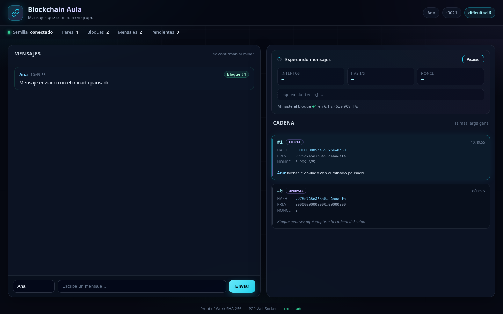

# ⛓️ Blockchain Aula

Blockchain educativa **P2P** para un salón de clases. Cada laptop es un nodo que:

- Se conecta a los demás por **WebSocket** (peer-to-peer).
- Recibe los mensajes que escriben todos y los guarda en su **mempool**.
- **Compite minando** un bloque con proof-of-work SHA-256.
- Propaga el bloque ganador y sincroniza la cadena con el resto.
- Muestra todo en una **interfaz web** en vivo.

Pensada para ~20 alumnos, sin base de datos y sin instalar nada raro: solo Node.js.



---

## Requisitos

- **Node.js 18 o superior** en cada laptop (recomendado 20+).
- Todas las laptops en la **misma red Wi-Fi / LAN**.
- Puertos libres: `3000` para cada nodo y `4000` para el nodo semilla.

Comprobar la versión:

```bash
node --version
```

---

## Instalación

En **cada laptop** (incluida la del profesor):

```bash
npm install
```

Solo se instalan dos dependencias: `express` y `ws`.

---

## Arrancar en el salón (3 pasos)

### 1. Profesor: nodo semilla

En la laptop del profesor:

```bash
node src/seed.js --port 4000 --difficulty 6
```

La terminal muestra algo así:

```
Comparte esta URL con tus alumnos:
  ws://192.168.1.50:4000
```

Esa es la URL que todos van a usar. El semilla **no mina ni guarda la cadena**: solo sirve para que los nodos se descubran.

### 2. Alumnos: cada uno arranca su nodo

Cada alumno, en su laptop:

```bash
node src/node.js --name "Ana" --seed ws://192.168.1.50:4000
```

Cambia `"Ana"` por el nombre del alumno y la IP por la que mostró el profesor.

### 3. Abrir la interfaz

Cada alumno abre en su navegador:

```
http://localhost:3000
```

También puede abrirla el profesor desde su propia laptop, o proyectar la de cualquier alumno.

---

## Cómo se usa

1. Escribe tu nombre y un mensaje. Al enviarlo, el mensaje entra al **mempool** de todos los nodos.
2. Todos los nodos empiezan a **minar** ese mensaje al mismo tiempo.
3. El primero que encuentra un hash válido crea el bloque y lo **propaga**.
4. Los demás validan el bloque, lo agregan a su cadena y dejan de minar ese candidato.
5. Si dos nodos encuentran bloques a la vez, se crea una **bifurcación**: gana la cadena más larga y los mensajes de la rama perdedora vuelven al mempool.

La tarjeta de minado muestra en vivo los intentos, el hash/s, el nonce y el último bloque que minó ese nodo.

---

## Cómo funciona (para explicarlo en clase)

### Mensaje = transacción

No hay wallets ni saldos. Un mensaje es:

```json
{
  "id": "a1b2c3d4",
  "author": "Ana",
  "text": "Hola",
  "timestamp": 1730000000000
}
```

Los mensajes pendientes viven en el **mempool**. Al minar un bloque, se confirman.

### Bloque y proof-of-work

```json
{
  "index": 1,
  "previousHash": "9975d745…",
  "timestamp": 1730000000000,
  "messages": [ ... ],
  "nonce": 314159,
  "hash": "000000a1b2c3…"
}
```

El hash se calcula así:

```
SHA-256( index | previousHash | timestamp | mensajes | nonce )
```

Para que el bloque sea válido, el hash debe empezar con **N ceros** (`--difficulty`). Encontrar ese nonce es el trabajo de minería. Cambiar cualquier dato del bloque cambia su hash y rompe la cadena.

### Consenso

La regla es **la cadena válida más larga gana**. Cuando un nodo recibe una cadena más larga, la valida completa y la adopta. Si una bifurcación pierde, sus mensajes vuelven al mempool para no perderse.

### Descubrimiento P2P

1. Cada nodo se conecta al **semilla** y le dice su nombre y puerto.
2. El semilla responde con la lista de los demás nodos.
3. Los nodos se conectan **directamente** entre sí (`ws://IP:PUERTO/p2p`).
4. A partir de ahí el semilla no interviene: los mensajes y bloques viajan por la red P2P.
5. Cada 20 s los nodos piden la lista actualizada por si entró alguien nuevo.

Si dos nodos se conectan al mismo tiempo, se queda una sola conexión (la inicia el nodo con `nodeId` menor).

### Dificultad

La dificultad la manda el **semilla** a todos los nodos, así nadie puede quedarse con una distinta.

| Dificultad | Tiempo aproximado (1 nodo) | Para qué |
|---|---|---|
| 4 | ~0.1 s | Probar solo, rápido |
| 5 | ~1.5 s | Demo pequeña (2–5 nodos) |
| 6 | ~30–40 s | **Salón de 20 nodos** (entre todos ~1–3 s) |

Con 20 laptops minando a la vez, la dificultad 6 da bloques de 1 a 3 segundos: se ve la competencia sin que la cadena explote.

---

## Configuración

| Flag | Variable de entorno | Por defecto | Descripción |
|---|---|---|---|
| `--port` | `PORT` | `3000` | Puerto HTTP + WebSocket del nodo |
| `--name` | `NODE_NAME` | `nodo-3000` | Nombre visible del nodo |
| `--seed` | `SEED_URL` | `ws://localhost:4000` | URL del nodo semilla |
| `--difficulty` | `DIFFICULTY` | `6` | Ceros iniciales del hash |
| `--host` | `HOST` | `0.0.0.0` | Interfaz de escucha |

Para el semilla:

| Flag | Por defecto | Descripción |
|---|---|---|
| `--port` / `--seed-port` | `4000` | Puerto del semilla |
| `--difficulty` | `6` | Dificultad que se reparte a los nodos |

---

## Probar varios nodos en una sola laptop

Abre tres terminales:

```bash
# Terminal 1: semilla
node src/seed.js --port 4000 --difficulty 4

# Terminal 2: nodo Ana
node src/node.js --port 3001 --name Ana --seed ws://localhost:4000

# Terminal 3: nodo Beto
node src/node.js --port 3002 --name Beto --seed ws://localhost:4000
```

Abre `http://localhost:3001` y `http://localhost:3002`, escribe desde uno y mira cómo el otro recibe el mensaje y compite por minarlo.

También hay atajos:

```bash
npm run seed     # semilla en 4000
npm run node1    # nodo en 3001
npm run node2    # nodo en 3002
npm run node3    # nodo en 3003
```

---

## Problemas comunes

### "No aparecen pares" / el semilla no conecta

- Verifica que la IP del profesor sea la correcta (`ip addr` en Linux, `ipconfig` en Windows).
- Que todos estén en la **misma red**.
- Que el firewall permita Node.js. En Windows, al arrancar, acepta el aviso de **Red privada**.
- Algunas redes de invitados tienen **aislamiento de clientes**: los equipos no se ven entre sí. Usa la red normal del aula o un router propio.

### "El puerto 3000 ya está en uso"

Otro nodo ya está corriendo en esa laptop. Usa otro puerto:

```bash
node src/node.js --port 3001 --name "Ana" --seed ws://IP:4000
```

### Las cadenas no coinciden entre nodos

Todos deben usar la **misma dificultad**. Como la reparte el semilla, basta con no cambiarla a mitad de clase. Si reinicias el semilla con otra dificultad, reinicia también los nodos.

### La laptop se calienta o la batería se agota

Todos los nodos minan mientras hay mensajes pendientes. Puedes pausar el minado con el botón **Pausar** de la interfaz; el nodo sigue recibiendo mensajes y sincronizando.

---

## Estructura del proyecto

```
proyecto_sockets_blockchain/
├── package.json
├── README.md
├── src/
│   ├── config.js       # flags y variables de entorno
│   ├── blockchain.js   # bloques, hash, PoW, mempool, consenso
│   ├── p2p.js          # WebSocket P2P, descubrimiento, deduplicación
│   ├── seed.js         # nodo semilla (solo descubrimiento)
│   └── node.js         # servidor HTTP + UI + orquestación del minado
└── public/
    ├── index.html
    ├── style.css
    └── app.js
```

### Endpoints útiles

- `GET /api/state` — estado completo del nodo en JSON (útil para depurar).
- `GET /api/health` — salud del nodo.
- `ws://IP:PUERTO/ws` — WebSocket de la interfaz.
- `ws://IP:PUERTO/p2p` — WebSocket entre nodos.

---

## Créditos

La lógica de bloques, proof-of-work y sincronización está inspirada en
[naivecoin](https://github.com/lhartikk/naivecoin) y
[naivechain](https://github.com/lhartikk/naivechain) de Lauri Hartikka,
simplificada para uso educativo: sin wallets, sin UTXO y con mensajes como
unidad de información.

Proyecto con fines didácticos. **No usar en producción**: no tiene firma
digital, ni resistencia a ataques Sybil, ni persistencia en disco.
